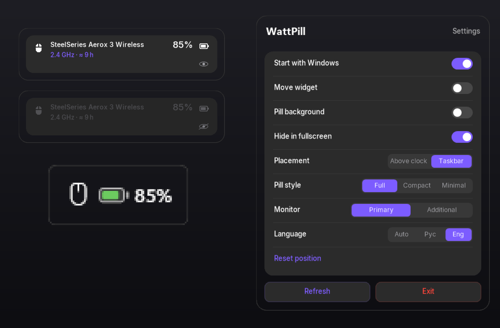

# JuiceBar

[](https://github.com/Exslayder/juicebar/releases/latest)
[](https://github.com/Exslayder/juicebar/actions/workflows/release.yml)
[](LICENSE)
[](#requirements)
[](#data--privacy)

Battery level **and remaining time** for wireless mice, headsets and controllers — right on the
Windows taskbar, without vendor software.



A small pill floats above the clock (or sits on the taskbar, if you prefer) and shows the real level
reported by each device. Click it and a compact panel opens with the device name, the estimated time
left, the percentage and a battery glyph. It closes 200 ms after the pointer leaves it (or on a
second click on the pill).

## Why another battery monitor

Most tools only repeat a percentage. JuiceBar answers the question you actually have: *"how long
until it dies?"* — and it is honest about it: a forecast is shown as a forecast, never as a
measurement, and it is labelled while the data is still thin.

- **Real device percentages.** The Razer Barracuda X reports its own 0–100 % over the 2.4 GHz
  receiver (customer data `0x21`), not a voltage guess. SteelSeries mice report their level in
  fixed 5 % steps, exactly like the mouse firmware does.
- **Remaining time at a glance.** A local regression over the observed discharge (up to 6 h) gives
  `≈ 3 h 20 min`. Nothing is uploaded and no account is needed.
- **All native, no Chromium.** ~1.8 MB exe: the pill, the panel, device polling and history are
  plain Win32 + GDI+. No WebView2, no Electron, no background Chromium processes. Idle CPU is
  0 ms/s and the working set is under 25 MB.
- **Sits above the clock.** The pill floats just above the clock and grows to the left as devices
  connect, so it never covers taskbar buttons, toolbars or widgets.
- **Starts with Windows.** Enabled on the first run; a checkbox in the right-click menu turns it
  off again (a single `HKCU\…\Run` value, no service, no admin rights).
- **Follows Windows.** Light/dark theme comes from the taskbar and updates live; 100–200 % DPI
  aware; Русский / English UI, switchable from the menu.

## Install

Download `JuiceBar-1.0.5-setup.exe` from the latest release and run it. The installer is per-user — no
administrator rights, no UAC prompt. By default it installs into
`%LOCALAPPDATA%\Programs\JuiceBar` and adds a Start menu shortcut; the wizard also lets you pick
another folder (for example `D:\Apps\JuiceBar`).

Release binaries are built by GitHub Actions from the tagged commit; the workflow runs the unit
tests, then produces the installer.

To remove the app, use *Settings → Apps → Installed apps → JuiceBar* or the uninstaller in the
install folder. Your settings and history are kept; delete `%APPDATA%\JuiceBar` and
`%LOCALAPPDATA%\JuiceBar` to remove them too.

## Supported devices

| Device family | Transport | What is read |
|---|---|---|
| SteelSeries Aerox 3 / 3 Gen 2 / 5 / 9 Wireless, Prime Wireless, CS2 and Diablo IV editions | 2.4 GHz receiver or USB cable | firmware battery step (0–100 % in 5 % steps; Gen 2 in 1 % steps) + charging flag |
| Razer Barracuda X (2022), PIDs `1532:0550` / `1532:0552` | 2.4 GHz dongle | headset's own percentage (`0x21`) + cable state (`0x2A`) |
| HyperX Cloud II Wireless, Cloud Alpha Wireless, Cloud Flight Wireless | 2.4 GHz USB dongle | the headset's own percentage (Cloud II / Alpha) or a voltage-based estimate (Flight), plus the charging flag |
| HyperX Cloud Stinger Core Wireless + 7.1 (`0951:170B`) | 2.4 GHz USB dongle | feature-report charge code + voltage estimate (charging / discharging curves) |
| Other HyperX dongles (experimental) | 2.4 GHz USB dongle | tries the same vendor protocols (including the feature-report one); a device is shown only if the dongle answers |
| Sony PULSE 3D (`054C:0D5E`) | 2.4 GHz USB dongle | pushed status reports: level in 10 % steps, charging state and connection flag (the dongle answers no queries; shown as `?` until the first report) |
| Xbox controllers (XInput) | wireless | coarse level (empty / low / medium / full → 5 / 20 / 60 / 100 %) |
| Bluetooth devices with a Windows battery level | Bluetooth LE / classic | the level Windows itself exposes (headsets, earbuds, mice, keyboards) |

Everything else is ignored: JuiceBar only sends read-only queries to devices it recognises.
Speakers that do not publish a battery level (most JBL, for example) cannot be shown — Windows has
no number to read.

## Accuracy

- A percentage is only shown when the device actually reports one (`0…100`). Out-of-range values
  are rejected instead of clamped silently.
- A device that stops answering keeps its last value, dimmed, with "no answer" — the last sample is
  never presented as fresh. A Bluetooth device that disconnects disappears after five minutes; a
  receiver that stays plugged in keeps its headset on screen as "off" (dimmed) with the last level.
- SteelSeries reports steps, so 45 % means "45 %"; Razer reports its own number; Xbox levels are
  coarse by nature and shown as such.
- Verified twice against the reference protocol reader (BatteryHub) with both tools running at the
  same moment: `75 % / 49 %` and `45 % / 49 %` for the Aerox 3 Wireless and Barracuda X — identical.
- Forecasts are suppressed when the drain is too small to measure (`< 0.8 %/h`) and capped at
  "more than a day", so an idle headset never reports a fantasy "4 days left".

## Remaining time

The forecast is a least-squares fit over the last discharge samples (up to 6 h; gaps and charging
sessions break the window).

| State | Panel text |
|---|---|
| less than 15 min of data | `Калибровка · ещё N мин` |
| steady level | `Расход стабилен` |
| forecast | `≈ 3 ч 20 мин` |
| charging | `Заряжается · до полного 1 ч 05 мин` when the charge rate is known |

## Polling

- Devices are polled once every **60 seconds** by a background thread. The Sony PULSE 3D is the
  exception: its dongle only pushes reports, so a second thread blocks on them and wakes the poller
  when something changes.
- An extra read happens immediately on start, on a device connect/disconnect (`WM_DEVICECHANGE`),
  after resume from sleep, and from *Refresh* in the menu.
- History keeps at most one sample per device per minute and is written to disk every 5 minutes
  and on exit, so faster polling would not add accuracy — only radio traffic and CPU.

## Menu

Right-click the pill:

- **Refresh** — poll the devices right now.
- **Start with Windows** — checked by default; toggles the `HKCU\…\Run` entry.
- **Placement** — *Above the clock* (default) or *On the taskbar*.
- **Language** — *Auto* (the Windows language), *Русский* or *English*.
- **Exit**.

## Languages

The first run follows the Windows UI language: a Russian Windows uses Russian, everything else
uses English. Right-click → Language lets you switch between *Auto*, *Русский* and *English*; the
choice is saved in `settings.ini` and applies immediately, including the duration strings in the
panel.

## Command line

```
JuiceBar.exe --once          print detected devices and exit
JuiceBar.exe --json          same as JSON
JuiceBar.exe --dump          list HID collections (for adding new devices)
JuiceBar.exe --fonts         report which UI fonts were resolved
JuiceBar.exe --fullscreen    report the fullscreen detection and exit
JuiceBar.exe --panel         start with the panel open
JuiceBar.exe --no-pill       hide the taskbar pill for this run
JuiceBar.exe --data <dir>    keep settings and history in <dir> (portable)
JuiceBar.exe --quit          close the running instance
```

## Requirements

- Windows 10 1903+ or Windows 11, x64.
- No administrator rights, no installer services, no runtime to install.
- About 25 MB of RAM and no measurable idle CPU.

## Build from source

The repository builds with MinGW-w64 (UCRT). A pinned portable toolchain can be fetched into the
project (no system installation):

```powershell
powershell -ExecutionPolicy Bypass -File scripts\toolchain.ps1
powershell -ExecutionPolicy Bypass -File build.ps1 -Version 1.0.5
powershell -ExecutionPolicy Bypass -File test.ps1
```

`build.ps1` compiles the native sources in `src\`, embeds the icons and the three Inter faces, and
writes a single self-contained `build\JuiceBar.exe`.

The build is reproducible: the linker does not insert a PE timestamp, so two builds of the same
commit with the same toolchain are byte-identical (SHA-256), and anyone can verify a release
binary by rebuilding it. The toolchain script also verifies the SHA-256 of the downloaded
MinGW archive before extracting it.

To build the installer you need [Inno Setup 6+](https://jrsoftware.org/isinfo.php):

```powershell
powershell -ExecutionPolicy Bypass -File installer\build-installer.ps1 -Version 1.0.5
```

The result is `dist\JuiceBar-<version>-setup.exe`.

## Data & privacy

- Settings: `%APPDATA%\JuiceBar\settings.ini`
- History: `%LOCALAPPDATA%\JuiceBar\history.tsv` (30 days, sampled once a minute)
- Autostart: `HKCU\Software\Microsoft\Windows\CurrentVersion\Run\JuiceBar`
- Nothing is sent anywhere: there is no HTTP client in the binary.
- `--data <dir>` or a `portable.flag` file next to the exe keeps everything in one folder.

## Limitations

- The pill follows a horizontal taskbar; vertical taskbars are not supported. It floats above the
  clock by default; *Placement → On the taskbar* puts it left of the tray.
- Windows has no supported API to pin a layered popup above its own topmost taskbar. After a
  screenshot or a taskbar focus change the shell can raise itself above the pill; a read-only
  z-order check once per second re-asserts the pill only when that actually happened (zero work
  and zero z-order calls while everything is stable).
- Bluetooth support depends on Windows exposing a battery level; many speakers do not.
- Only the device families above are queried. More drivers can be added one at a time.

## Design

The visual system, icon sources and the taskbar z-order notes are documented in
[docs/DESIGN.md](docs/DESIGN.md).

## Credits

See [CREDITS.md](CREDITS.md). Icons: Material Symbols Rounded (Apache-2.0) and Fluent System Icons
(MIT). Text: Inter (OFL). The application icon is the Fluent `flash` glyph on a generated violet
squircle.

## License

MIT — see [LICENSE](LICENSE).
